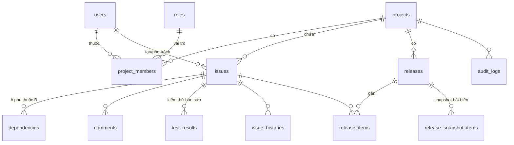

# Cơ sở dữ liệu

MySQL/MariaDB, **InnoDB**, **utf8mb4** (`utf8mb4_unicode_ci`). Thời gian lưu **UTC** (`time_zone='+00:00'` cho mỗi kết nối) và hiển thị theo **giờ Việt Nam (UTC+7)** ở tầng view (`Support\Time`).

## ERD

## Bảng
| Bảng | Mục đích | Ràng buộc đáng chú ý |
|---|---|---|
| `users` | Tài khoản, `password_hash`, `is_admin`, `is_active` | `UNIQUE(email)` |
| `roles` | 5 vai trò | PK `code` |
| `projects` | 16 dự án mẫu; `issue_counter` sinh số thứ tự; `archived_at` (lưu trữ, không xóa) | `UNIQUE(code)` |
| `project_members` | Thành viên + vai trò theo dự án | `UNIQUE(project_id, user_id)`, FK `roles` |
| `issues` | Bug/Task/Improvement; `version` (khóa lạc quan); `fix_ref`, `fix_revision` | `UNIQUE(project_id, number)`, `UNIQUE(project_id, code)`, `UNIQUE(id, project_id)` |
| `dependencies` | A (`issue_id`) phụ thuộc B (`depends_on_id`) | `UNIQUE(issue_id, depends_on_id)`, `CHECK(issue_id <> depends_on_id)`, **FK phức hợp `(issue_id, project_id)` và `(depends_on_id, project_id)` → `issues(id, project_id)`** ⇒ DB tự chặn liên kết chéo dự án |
| `comments`, `test_results`, `issue_histories` | Bình luận, kết quả kiểm thử (`result`, `fix_revision`, `fix_ref`), lịch sử thay đổi (JSON) | FK phức hợp `(issue_id, project_id)` |
| `releases` | Phiên bản (`status` planned/released, `snapshot_checksum`, `readiness_report`) | `UNIQUE(project_id, name)`, `UNIQUE(id, project_id)` |
| `release_items` | Công việc gắn vào phiên bản (`is_required`) | `UNIQUE(release_id, issue_id)`, FK phức hợp tới `releases` và `issues` cùng `project_id` |
| `release_snapshot_items` | **Bản sao** dữ liệu tại thời điểm chốt (không chỉ `issue_id`) | `UNIQUE(release_id, issue_id)`; trigger bất biến |
| `audit_logs` | Nhật ký thao tác (đăng nhập, chốt, đổi vai trò…) | |
| `schema_migrations` | Theo dõi migration đã chạy | |

Chỉ mục: theo `(project_id, status|assignee_id|severity|type|updated_at)`, `dependencies(depends_on_id, issue_id)`, `issue_histories(issue_id, id)` …

## Trigger (migration `002`)
`trg_snapshot_bi/bu/bd` (chỉ thêm snapshot khi phiên bản còn `planned`; cấm sửa/xóa), `trg_release_bu/bd` (phiên bản đã `released` không sửa/xóa), `trg_item_bi/bu/bd` (không đổi danh sách công việc của phiên bản đã chốt). Vi phạm ⇒ `SQLSTATE 45000`.

## Xóa / lưu trữ
Không có luồng xóa công việc, bình luận, kiểm thử, lịch sử hay phiên bản; khóa ngoại `RESTRICT`. Dự án được **lưu trữ** (`archived_at`) thay vì xóa. Gỡ thành viên chỉ bỏ phân công các việc của họ (lịch sử giữ nguyên).

## Khởi tạo – hai cách tương đương
- **Cách A:** `php bin/migrate.php` (`database/migrations/*.sql`, tách lệnh bằng dòng `-- ;;`) rồi `php bin/seed.php`.
- **Cách B:** import `database/releasehub.sql` vào database **trống**. Tệp này tạo trigger *sau* khi nạp dữ liệu và chứa hàng `schema_migrations` tương ứng ⇒ chạy `php bin/migrate.php` sau đó báo "Không có migration mới".
Đã kiểm tra: dump → import vào DB trống → so sánh fingerprint MD5 từng bảng với DB dựng bằng migration+seeder: **khớp** (trừ `password_hash`, do muối bcrypt ngẫu nhiên, và `applied_at`). Hiệu lực mật khẩu: đăng nhập thử thành công với DB import.
**Không chạy cả hai** trên cùng một database.

## Dữ liệu mẫu (seeder xác định)
16 dự án (đúng bảng trong đề) × 20 công việc (12 Bug, 5 Task, 3 Improvement) = **320**; **244** phụ thuộc (15–16/dự án, không có vòng); **48** phiên bản (v1.0.0 đã chốt qua chính `ReleaseSnapshotService`, v1.1.0 và v1.2.0 dự kiến); 144 kết quả kiểm thử, 464 bình luận, 1.064 dòng lịch sử. Phân bố kịch bản phiên bản v1.1.0: 4 sẵn sàng · 8 bị Blocker chặn (trong đó 4 Blocker đã sửa lại sau khi Passed nên cần kiểm thử lại, 4 có kiểm thử thất bại và mở lại) · 4 bị phụ thuộc ngoài phiên bản chặn. Nội dung lỗi/bước tái hiện/bình luận/mô tả phiên bản viết riêng cho từng lĩnh vực (`database/Seeders/Data/projects_*.php`); test `testNoCopiedIssueSetsAcrossProjects` bảo đảm không trùng tiêu đề/bước tái hiện.
Đồ thị luôn hợp lệ (không lưu sẵn vòng); tình huống tạo vòng thực hiện bằng test/demo.
Lệnh reset tách riêng: `php bin/reset.php --confirm=<tên database>`.
